# Retrograde 1.0

An early-2010s Spotify desktop theme: graphite panels, silver controls, compact tables and classic green accents.

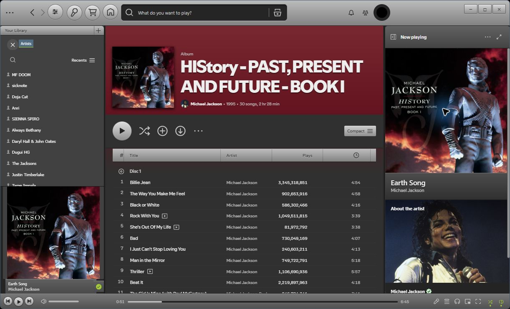

## A familiar desktop, made yours

### Expanded artwork or a compact player

The artwork and track-details band form one flush block above the playback strip. Hover over the cover to reveal the top-right collapse button, or focus it with the keyboard. It moves the artwork and details completely into the playback bar. Hover over the compact thumbnail to expand again, or use **Preferences → Artwork above playback bar**. The choice saves locally and survives restart.

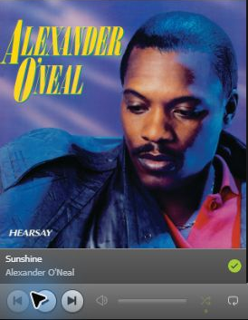

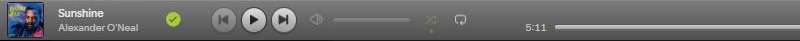

### Classic controls and compact tables

Silver chrome, graphite surfaces, clear column headers and a slim playback strip bring the early Spotify desktop back into focus. The native song artwork and details sit above the lower-left transport controls, just like the classic desktop; collapsing the library keeps a compact song widget inside the strip.

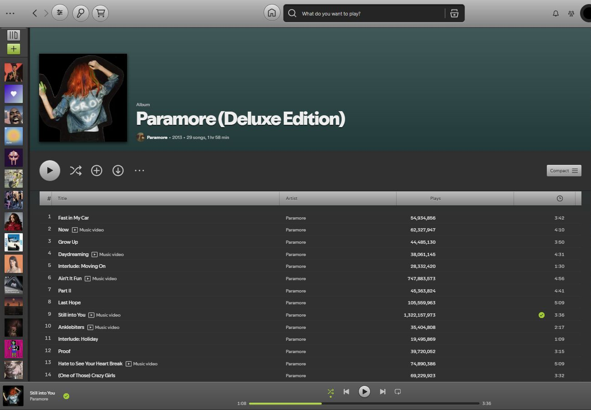

### Home and artist pages

Home keeps dense discovery shelves on a solid graphite surface. Artist pages retain their full banner, with Popular tracks presented as a compact table.

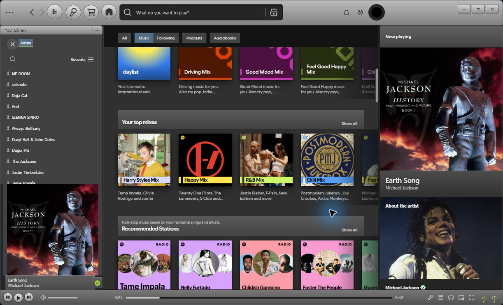

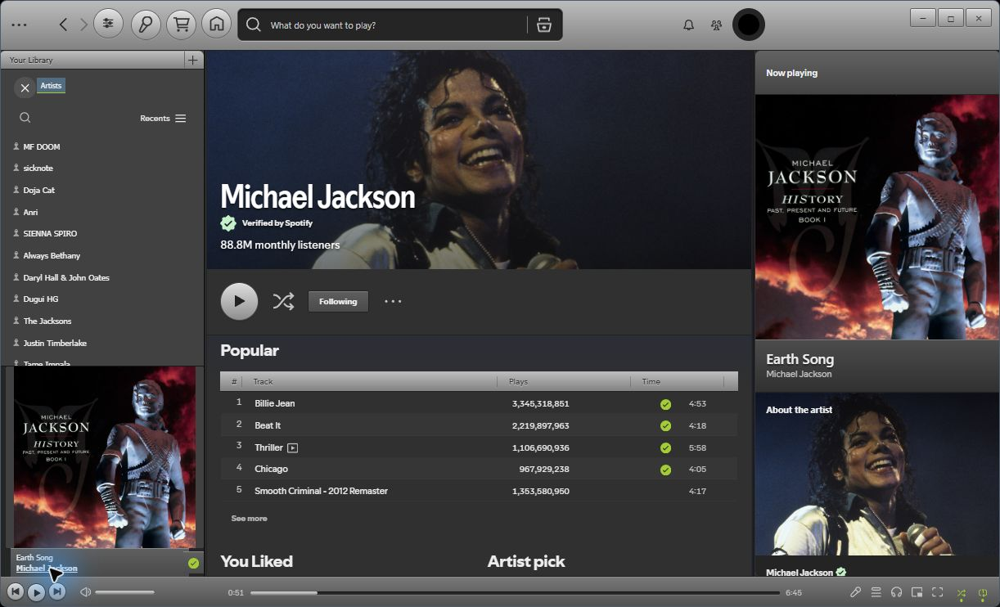

### Lyrics with room to breathe

Centered native lyrics, a larger highlighted current line and a framed artwork card. Move the song information left or right in Preferences; the library rail and an open Queue keep their space.

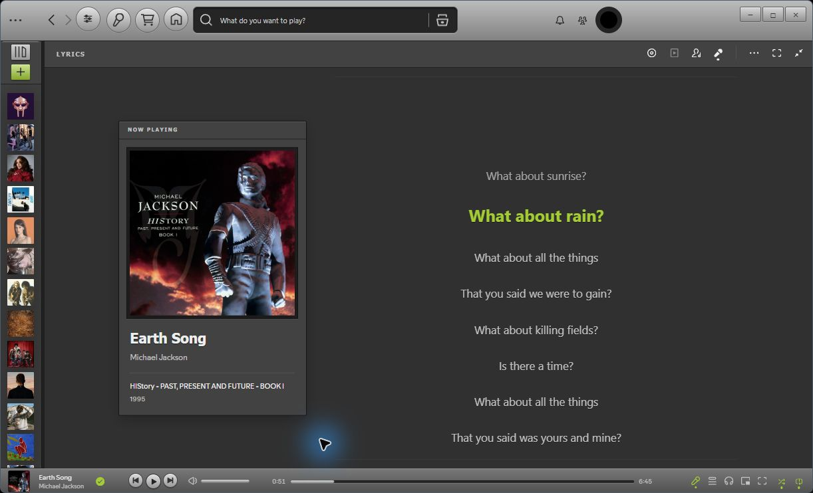

### Keep the essentials close

The Queue uses dense Track/Artist rows. Now Playing focuses on cover art, title, artists and About the artist. Both sidebars support resizing.

<table>
<tr><th>Classic Queue</th><th>Focused Now Playing</th></tr>
<tr><td>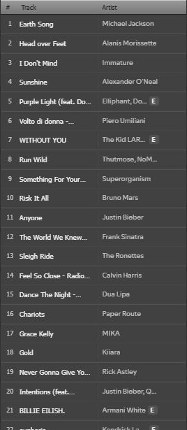</td><td>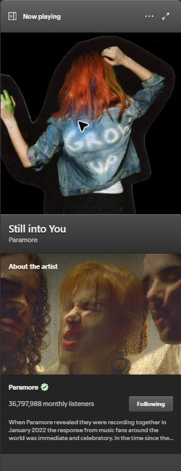</td></tr>
</table>

### Your palette, your preferences

Start with one of ten curated schemes, then adjust colors, density, typography, track artwork, sidebar widths and motion. Changes preview immediately and save locally.

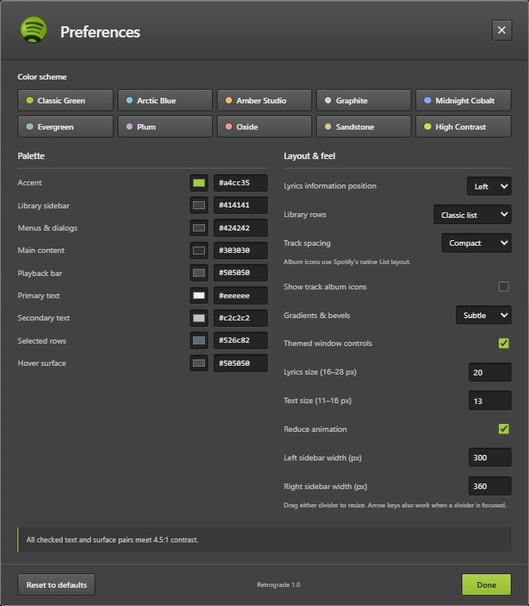

The same album page in four alternative schemes; Classic Green is shown above. Click an image to inspect the full client capture.

| Arctic Blue | Amber Studio |
| --- | --- |
| 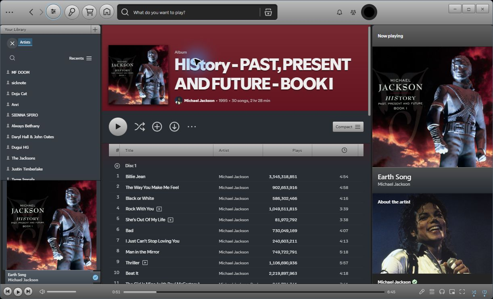 | 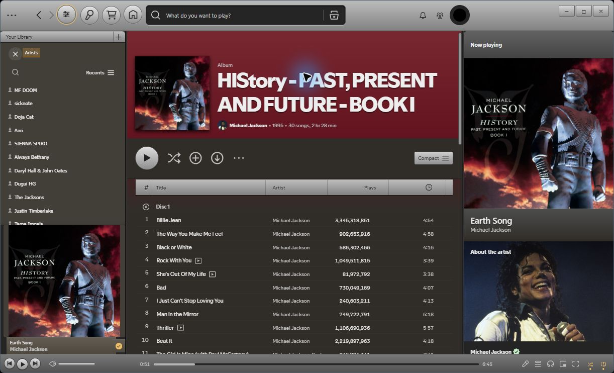 |
| Midnight Cobalt | Plum |
| 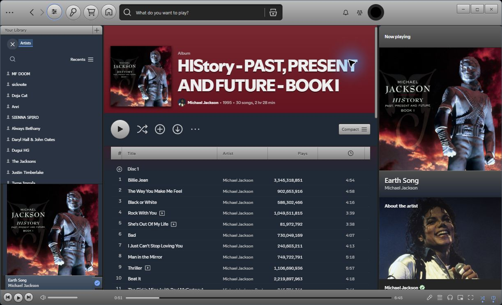 | 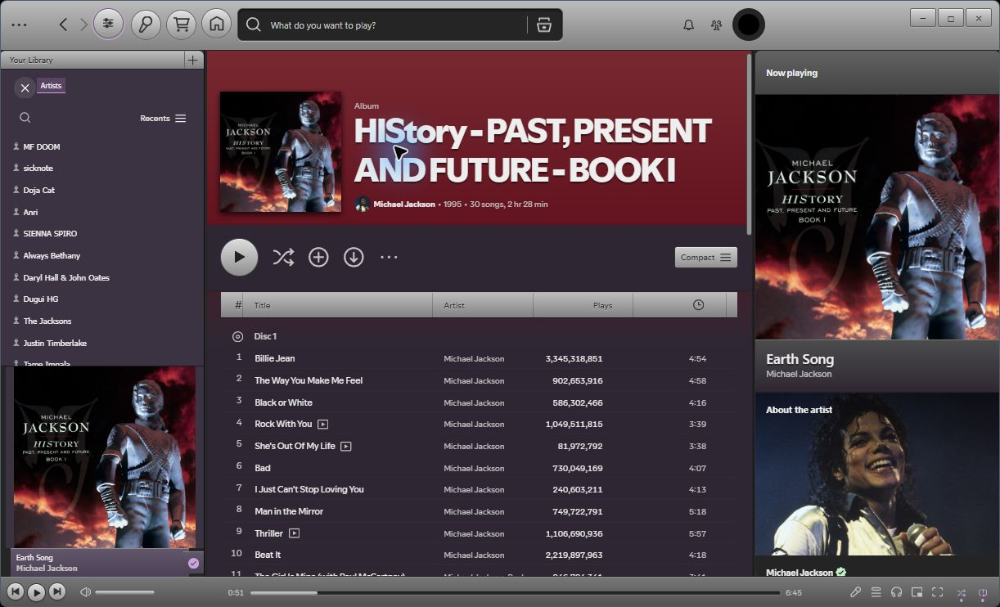 |

All images are captures from the actual Windows Spotify client running Retrograde 1.0. Some views are cropped to emphasize a feature and omit personal library details and unrelated overlays.

## Features

- Classic library rows and Track/Artist Queue tables.
- Resizable sidebars with sensible width limits.
- Native lyrics framed by the library and Queue, with an artwork/metadata card.
- Ten color presets and editable accent, surface, text, selection and hover colors.
- Compact/comfortable density, optional track artwork, text/lyrics sizes, relief and reduced motion.
- Native playback, search, context menus, navigation and virtualized scrolling.
- Subtle remote-device status above the timeline; click it to open Spotify's device picker without adding another playback-bar row.

## Compatibility

Tested on **Windows, Spotify 1.3.6.1921 and Spicetify 2.46.4**. Other versions/platforms are unverified. Spotify updates can change private selectors or APIs. Arbitrary Marketplace snippets, extensions and apps may override the same styling or behavior.

## Install

### Spicetify Marketplace

Search for **Retrograde** under Themes, install it and accept Marketplace's requested reload. The companion JavaScript is required for Preferences and layout features and is included by the manifest. Marketplace installation does not run the PowerShell installer.

If Marketplace asks for its placeholder theme, follow its setup instructions first. Public distribution validation is tracked in [Marketplace publication](docs/MARKETPLACE.md).

### Manual installation

Download and extract the release archive. On Windows, with Spicetify already installed and available in your terminal:

```powershell
./scripts/Install.ps1
```

The installer backs up the existing configuration and any prior Retrograde theme in the extracted folder's backups directory. Keep that folder for rollback. Existing configured apps/extensions remain enabled.

Alternatively, copy the three files in dist/Retrograde to the Retrograde folder under your Spicetify Themes directory, then run:

```sh
spicetify config current_theme Retrograde color_scheme Classic inject_css 1 replace_colors 1 inject_theme_js 1
spicetify apply
```

## Preferences

Click the round sliders icon beside Back/Forward, or choose **Retrograde theme settings** from the profile menu. Changes preview and save locally. Presets preserve layout choices; Reset restores defaults. Lyrics information can appear left or right. Track album icons default off.

Drag a sidebar divider to resize, or focus it and use the arrow keys (Shift makes larger steps). Widths can also be set in Preferences. The native current-track widget docks above the player strip with the library expanded, and sits inside the strip with the library collapsed. Lyrics uses Spotify's own availability and synchronization; no replacement lyrics provider is installed.

## Update or remove

Marketplace users update through Marketplace and reload when prompted. To remove it, select another theme/uninstall Retrograde and perform the requested reload. Preferences are retained locally for a later reinstall.

For manual updates, rebuild or download a new release, replace the installed files and run `spicetify refresh`, then reload Spotify. To restore the configuration backed up by the manual installer:

```powershell
./scripts/Rollback.ps1
```

Disable **Themed window controls** in Preferences to use native captions. Private caption APIs fall back to native controls when unavailable.

## Development

Editable source and reproducible build scripts are included. No npm dependencies are required. See [development and verification](docs/DEVELOPMENT.md), [performance observations](docs/PERFORMANCE.md), [release notes](CHANGELOG.md) and [publication status](docs/MARKETPLACE.md).

## Credits and license

Inspired by [Spicetify Throwback](https://github.com/bluedrift/Spicetify-Throwback) and historical Spotify desktop interfaces. See [third-party notices](docs/THIRD_PARTY.md). Retrograde's original code is MIT licensed. Spotify names/logos and displayed artwork remain their owners' property. This is an unofficial project, unaffiliated with Spotify.
